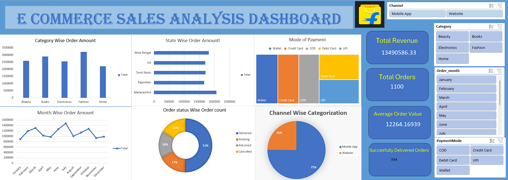

# 🛒 Ecommerce Sales Analysis Dashboard

## Dashboard Preview

## Project Overview

Interactive Ecommerce Sales Dashboard built using Microsoft Excel.

## Features

- Category-wise Revenue Analysis
- State-wise Revenue Analysis
- Monthly Revenue Trends
- Payment Mode Analysis
- Order Status Analysis
- Interactive Slicers
- KPI Cards

## Dashboard KPIs

- Total Revenue
- Total Orders
- Average Order Value
- Successfully Delivered Orders

## Tools Used

- Microsoft Excel
- Pivot Tables
- Pivot Charts
- Slicers
- Data Cleaning

## Files Included

- Ecommerce_Dashboard.xlsx
- Ecommerce_Raw_Data.csv
- dashboard.png

## Author

Manan Badala